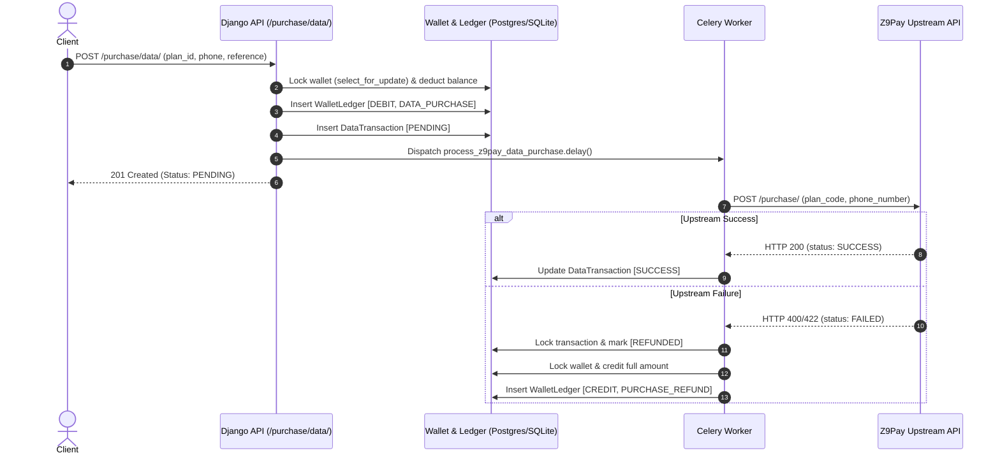

# Z9Pay VTU Backend API

A production-ready Virtual Top-Up (VTU) and digital payments backend service built with **Django**, **Django REST Framework (DRF)**, and **Celery**. It provides a secure financial wallet architecture with automated Dedicated Virtual Accounts (DVA) via **Paystack**, phone-number-based JWT authentication, concurrency-safe transactions, automated data vending through the **Z9Pay Developer API**, and a flexible telecom data catalog with circuit breakers.

---

## Table of Contents

- [Overview](#overview)
- [Key Features](#key-features)
- [Tech Stack](#tech-stack)
- [Project Architecture & Directory Structure](#project-architecture--directory-structure)
- [Getting Started](#getting-started)
  - [Prerequisites](#prerequisites)
  - [Installation & Setup](#installation--setup)
  - [Environment Variables](#environment-variables)
  - [Database Migrations & Superuser](#database-migrations--superuser)
  - [Running the Application](#running-the-application)
- [API Documentation](#api-documentation)
  - [Authentication Endpoints](#authentication-endpoints)
  - [Wallet & Funding Endpoints](#wallet--funding-endpoints)
  - [Catalog & Plans Endpoints](#catalog--plans-endpoints)
  - [Data Purchase & Transactions Endpoints](#data-purchase--transactions-endpoints)
- [Z9Pay Integration & Sandbox Mock Mode](#z9pay-integration--sandbox-mock-mode)
  - [Sandbox Testing Strategy](#sandbox-testing-strategy)
- [Asynchronous Processing & Celery Tasks](#asynchronous-processing--celery-tasks)
  - [Background Task Overview](#background-task-overview)
  - [Eager Mode vs. Celery Worker](#eager-mode-vs-celery-worker)
- [Architecture & Financial Safety](#architecture--financial-safety)
  - [Two-Phase Purchase & Automatic Refunds](#two-phase-purchase--automatic-refunds)
  - [Row-Level Locking & Idempotency](#row-level-locking--idempotency)
  - [Paystack Webhook Verification](#paystack-webhook-verification)
  - [Catalog Circuit Breakers](#catalog-circuit-breakers)
- [Testing](#testing)
- [License](#license)

---

## Overview

The **Z9Pay VTU Backend** powers automated digital service vending (data bundles, airtime, and bill payments). The system is engineered around financial safety, auditability, and resilience:
- **No Double-Spending**: All balance deductions utilize database row-level locking (`select_for_update`) within atomic transactions.
- **Automated Virtual Accounts**: Instantly provisions Paystack Dedicated Virtual Accounts (DVA) upon signup so users fund wallets via direct bank transfers.
- **Two-Phase Vending with Auto-Refunds**: Wallets are safely locked and debited before calling upstream suppliers. If Z9Pay reports a delivery failure, funds are credited back to the user's wallet automatically.
- **Audit-Ready Financial Ledger**: Every credit and debit is permanently recorded in an immutable `WalletLedger` capturing `balance_before` and `balance_after` financial snapshots.
- **Zero-Setup Local Testing**: Built-in mock mode simulates Z9Pay API responses locally without burning real API balances.
- **Catalog Auto-Sync**: Background Celery task syncs live data plans and prices directly from Z9Pay with automatic markup calculations.

---

## Key Features

- **Custom User Authentication**:
  - Phone-number-based primary identifier (`USERNAME_FIELD = "phone_number"`).
  - Stateless authentication with JSON Web Tokens (`djangorestframework-simplejwt`).
- **Financial Wallet & Ledger Engine**:
  - Real-time balance validation with non-negative constraints.
  - Double-entry-style immutable ledger tracking transaction types (`CREDIT`, `DEBIT`) and sources (`PAYSTACK_DVA`, `PAYSTACK_CARD`, `DATA_PURCHASE`, `PURCHASE_REFUND`, `ADMIN_ADJUSTMENT`).
  - Strict idempotency guarantees preventing duplicate webhook processing or repeated user requests.
- **Paystack Payment Integration**:
  - Automated customer creation and Dedicated Virtual Account (DVA) assignment via Django signals.
  - Cryptographic HMAC-SHA512 webhook signature verification.
  - Automatic wallet crediting on bank transfers (`dedicatedaccount.assign.success`, `charge.success`).
- **Data Bundle Vending Engine (`transactions`)**:
  - Direct purchase endpoint (`POST /api/v1/purchase/data/`).
  - Pre-flight wallet balance checks and selling price deduction.
  - Transaction status states: `PENDING` -> `SUCCESS`, `FAILED`, or `REFUNDED`.
  - Profit tracking (`amount_charged - cost_price`) recorded per transaction.
  - Paginated transaction history and individual status lookup endpoints.
- **Z9Pay Developer API Client (`z9pay_integration`)**:
  - Isolated client managing developer profile, data networks, data plans, purchases, and status verification.
  - Mock sandbox mode for effortless Postman testing of success and failure branches.
- **Asynchronous Task Queue (`Celery + Redis`)**:
  - Non-blocking purchase processing dispatched via `process_z9pay_data_purchase`.
  - Automated status verification for timed-out transactions via `verify_pending_z9pay_transaction`.
  - Live catalog synchronization task `sync_catalog_from_z9pay`.
- **Telecom Catalog & Circuit Breakers (`catalog`)**:
  - Supports major Nigerian telcos (MTN, Airtel, Glo, 9mobile) and plan tiers (SME, Corporate Gifting, Direct Gifting, Awoof).
  - Admin circuit breaker: Disabling a network instantly hides all associated plans from the API.

---

## Tech Stack

| Layer | Technology |
|---|---|
| **Language** | Python 3.12+ (tested on Python 3.14) |
| **Framework** | Django 6.1 |
| **API Framework** | Django REST Framework (DRF 3.18+) |
| **Authentication** | SimpleJWT (JWT Bearer tokens) |
| **Database** | SQLite (Default/Development), PostgreSQL supported (`psycopg2-binary`) |
| **Asynchronous Queue** | Celery 5.6+ with Redis 8+ |
| **Payment Gateway** | Paystack Dedicated Virtual Accounts (DVA) |
| **VTU Provider** | Z9Pay Developer API |
| **Configuration** | Python-Decouple (`.env`) |

---

## Project Architecture & Directory Structure

```text
z9pay_vtu_backend/
├── catalog/                     # Telco networks, data plans, pricing & circuit breakers
│   ├── admin.py                 # Admin customization (inline price editing, profit display)
│   ├── models.py                # Network and DataPlan models
│   ├── serializers.py           # Catalog DRF serializers
│   ├── tasks.py                 # Celery task to auto-sync plans & cost prices from Z9Pay
│   ├── urls.py                  # Catalog API routes (/networks/, /plans/)
│   └── views.py                 # Public catalog endpoints with query filtering
├── config/                      # Project root configuration
│   ├── celery.py                # Celery instance configuration & autodiscovery
│   ├── settings.py              # Django, JWT, Paystack, Z9Pay, & Celery configuration
│   ├── urls.py                  # Root URL routing (/api/v1/...)
│   ├── asgi.py
│   └── wsgi.py
├── transactions/                # Data vending transactions & auto-refunds
│   ├── models.py                # DataTransaction model (PENDING/SUCCESS/FAILED/REFUNDED)
│   ├── serializers.py           # Purchase input & transaction serializers
│   ├── tasks.py                 # Celery tasks: fulfillment, auto-refunds & verification
│   ├── urls.py                  # Transaction history & status lookup routes
│   └── views.py                 # PurchaseDataView, TransactionListView, TransactionDetailView
├── users/                       # User management & authentication
│   ├── models.py                # Custom User model (phone_number as USERNAME_FIELD)
│   ├── serializers.py           # User registration serializer
│   ├── urls.py                  # Auth routes (/register/, /login/, /token/refresh/)
│   └── views.py                 # Registration view
├── wallet/                      # Wallet balances, double-entry ledger & Paystack
│   ├── models.py                # Wallet and immutable WalletLedger models
│   ├── paystack.py              # Paystack client & HMAC-SHA512 webhook verification
│   ├── serializers.py           # Wallet & Ledger serializers
│   ├── services.py              # Concurrency-safe WalletService (credit/debit with row lock)
│   ├── signals.py               # Post-save signal to create wallet & request DVA
│   ├── urls.py                  # Wallet & webhook routes
│   └── views.py                 # Wallet balance, statement, Paystack webhook handler
├── z9pay_integration/           # Isolated Z9Pay Developer API client
│   ├── client.py                # Z9PayClient (profile, networks, plans, purchase, mock mode)
├── manage.py
├── requirments.txt              # Project dependencies
├── .env.example                 # Example environment variables
└── README.md
```

---

## Getting Started

### Prerequisites

Ensure you have the following installed:
- **Python 3.12+**
- **Git**
- **Redis Server** (optional for local development when `CELERY_TASK_ALWAYS_EAGER=True`)

---

### Installation & Setup

1. **Clone the repository**:
   ```bash
   git clone https://github.com/your-username/z9pay_vtu_backend.git
   cd z9pay_vtu_backend
   ```

2. **Create and activate a virtual environment**:
   - **Windows (PowerShell)**:
     ```powershell
     python -m venv venv
     .\venv\Scripts\Activate.ps1
     ```
   - **Linux / macOS**:
     ```bash
     python3 -m venv venv
     source venv/bin/activate
     ```

3. **Install dependencies**:
   ```bash
   pip install -r requirments.txt
   ```

---

### Environment Variables

Copy `.env.example` to create your `.env` file:

```bash
cp .env.example .env
```

Configure the environment variables according to your environment:

```ini
# Django Settings
SECRET_KEY=your-secure-django-secret-key-here
DEBUG=True

# Paystack API Configuration
PAYSTACK_SECRET_KEY=sk_test_your_paystack_secret_key
PAYSTACK_PREFERRED_BANK=wema-bank

# Z9Pay Upstream API Configuration
Z9PAY_BASE_URL=https://backend.z9pay.com.ng/api/v1/developer
Z9PAY_API_KEY=your_z9pay_developer_api_key
Z9PAY_MOCK_MODE=True

# Celery Configuration
CELERY_BROKER_URL=redis://localhost:6379/0
CELERY_RESULT_BACKEND=redis://localhost:6379/0
CELERY_TASK_ALWAYS_EAGER=True
```

#### Environment Variables Reference

| Variable | Default | Purpose |
|---|---|---|
| `SECRET_KEY` | `unsafe_secret_key` | Django cryptographic signing key. |
| `DEBUG` | `True` | Debug mode for development. Set to `False` in production. |
| `PAYSTACK_SECRET_KEY` | - | Paystack Secret Key for DVA assignment and webhook signing. |
| `PAYSTACK_PREFERRED_BANK` | `test-bank` | Preferred partner bank for DVAs (`wema-bank`, `titan-bank`, etc.). |
| `Z9PAY_BASE_URL` | `https://backend.z9pay.com.ng/api/v1/developer` | Upstream Z9Pay Developer API endpoint. |
| `Z9PAY_API_KEY` | - | API Bearer token provided by your Z9Pay Developer account. |
| `Z9PAY_MOCK_MODE` | `True` | When `True`, mocks Z9Pay responses locally for testing without real charges. |
| `CELERY_BROKER_URL` | `redis://localhost:6379/0` | Message broker URL for Celery. |
| `CELERY_RESULT_BACKEND` | `redis://localhost:6379/0` | Result backend for Celery task states. |
| `CELERY_TASK_ALWAYS_EAGER` | `True` | When `True`, executes Celery tasks synchronously in-process (no Redis required for testing). |

---

### Database Migrations & Superuser

1. Apply migrations:
   ```bash
   python manage.py migrate
   ```

2. Create an admin superuser:
   ```bash
   python manage.py createsuperuser
   ```
   *(Enter phone number, email, first name, last name, and password when prompted).*

---

### Running the Application

#### Option A: Local Development (Synchronous Eager Mode)
With `CELERY_TASK_ALWAYS_EAGER=True` in your `.env`, Celery tasks execute immediately within the Django process. You only need to run:

```bash
python manage.py runserver
```

- API Base: `http://127.0.0.1:8000/`
- Admin Panel: `http://127.0.0.1:8000/admin/`

#### Option B: Full Asynchronous Stack (Production / Staging)
Set `CELERY_TASK_ALWAYS_EAGER=False` and start both the web server and the Celery worker:

1. **Start Redis**:
   ```bash
   redis-server
   ```
2. **Start Django**:
   ```bash
   python manage.py runserver
   ```
3. **Start Celery Worker** (in a separate terminal):
   ```bash
   celery -A config worker --loglevel=info
   ```

---

## API Documentation

All API endpoints are versioned under `/api/v1/`.

### Authentication Endpoints

Base Path: `/api/v1/auth/`

| Method | Endpoint | Description | Auth Required |
|---|---|---|---|
| `POST` | `/api/v1/auth/register/` | Register new user & automatically request Paystack DVA | No |
| `POST` | `/api/v1/auth/login/` | Obtain JWT access and refresh token pair | No |
| `POST` | `/api/v1/auth/token/refresh/` | Refresh an expired access token | No |

#### Registration Payload (`POST /api/v1/auth/register/`):
```json
{
  "phone_number": "08012345678",
  "email": "user@example.com",
  "first_name": "Amina",
  "last_name": "Bello",
  "password": "SecurePassword123"
}
```

#### Login Payload (`POST /api/v1/auth/login/`):
```json
{
  "phone_number": "08012345678",
  "password": "SecurePassword123"
}
```

---

### Wallet & Funding Endpoints

Base Path: `/api/v1/wallet/`

| Method | Endpoint | Description | Auth Required |
|---|---|---|---|
| `GET` | `/api/v1/wallet/` | Retrieve wallet balance & assigned bank account | Bearer JWT |
| `GET` | `/api/v1/wallet/ledger/` | Get chronological statement of credits & debits | Bearer JWT |
| `POST` | `/api/v1/wallet/webhook/` | Paystack webhook for payments & DVA generation | HMAC Signature |

#### Sample Wallet Response (`GET /api/v1/wallet/`):
```json
{
  "id": "748888b1-3816-4eb9-bf25-05aa504547be",
  "balance": "3500.00",
  "bank_name": "Wema Bank",
  "account_number": "9921234567",
  "account_name": "PAYSTACK / AMINA BELLO",
  "is_locked": false,
  "created_at": "2026-11-10T12:00:00Z"
}
```

---

### Catalog & Plans Endpoints

Base Path: `/api/v1/catalog/`

| Method | Endpoint | Description | Auth Required |
|---|---|---|---|
| `GET` | `/api/v1/catalog/networks/` | List all active telco networks | No |
| `GET` | `/api/v1/catalog/plans/` | List available data plans (filterable) | No |

#### Query Filters for `/plans/`:
- `network`: Filter by network code (e.g. `?network=MTN`, `?network=AIRTEL`)
- `category`: Filter by category (e.g. `?category=SME`, `?category=CORPORATE`)

```http
GET /api/v1/catalog/plans/?network=MTN&category=SME
```

---

### Data Purchase & Transactions Endpoints

#### 1. Purchase Data Bundle
**`POST /api/v1/purchase/data/`**  
*(Requires `Authorization: Bearer <token>`)*

Deducts selling price from the user's wallet, records an immutable ledger debit, logs a `PENDING` transaction, and dispatches the fulfillment job to Celery.

**Request Body:**
```json
{
  "plan_id": "c8b417e2-4148-43bb-a536-1e6b539cf243",
  "phone_number": "08012345678",
  "reference": "REQ-TXN-1731600001"
}
```

**Successful Response (`201 Created` / `200 OK` on retry):**
```json
{
  "id": "1a457494-b258-45a8-ba50-1312304859df",
  "reference": "REQ-TXN-1731600001",
  "z9pay_reference": "Z9P_OK_4A7C9F12",
  "network": "MTN",
  "plan_name": "1GB SME Monthly",
  "phone_number": "08012345678",
  "amount_charged": "280.00",
  "status": "SUCCESS",
  "response_message": "Successfully delivered 1001 to 08012345678.",
  "created_at": "2026-11-14T15:20:00Z",
  "updated_at": "2026-11-14T15:20:01Z"
}
```

#### 2. List User Purchases
**`GET /api/v1/transactions/`**  
*(Requires `Authorization: Bearer <token>`)*

Returns the authenticated user's purchase history in reverse-chronological order.

#### 3. Single Purchase Status Lookup
**`GET /api/v1/transactions/<reference>/`**  
*(Requires `Authorization: Bearer <token>`)*

Retrieve full status and message for a specific purchase by its client-supplied reference.

---

## Z9Pay Integration & Sandbox Mock Mode

The `z9pay_integration` application contains an isolated `Z9PayClient` that communicates with the Z9Pay Developer API:
- `get_profile()`: Verifies API keys and returns developer account balance.
- `get_data_networks()`: Fetches supported telco networks.
- `get_network_data_plans(network_id)`: Fetches data plans and supplier prices.
- `purchase_data(network_id, plan_code, phone_number, reference)`: Submits purchase orders.
- `verify_purchase(reference)`: Queries transaction status on Z9Pay.

### Sandbox Testing Strategy

When `Z9PAY_MOCK_MODE=True`, you can test all scenarios in Postman without connecting to real telco networks or spending developer funds:

| Test Scenario | Input Phone Number | Simulated Outcome | Action Taken |
|---|---|---|---|
| **Successful Delivery** | Any regular number (e.g., `08012345678`) | `SUCCESS` | Status updated to `SUCCESS`, profit recorded. |
| **Failed Delivery & Auto-Refund** | Any number ending in `0000` (e.g., `08099990000`) | `FAILED` | Status set to `REFUNDED`, wallet credited back immediately with a `PURCHASE_REFUND` ledger record! |

---

## Asynchronous Processing & Celery Tasks

### Background Task Overview

Celery handles tasks that should not block HTTP request/response lifecycles:

1. **`process_z9pay_data_purchase(transaction_id)`**:
   - Triggered when a purchase is made.
   - Calls `Z9PayClient.purchase_data()`.
   - On success: marks `DataTransaction` as `SUCCESS`.
   - On failure: marks transaction as `REFUNDED` and executes `WalletService.credit_wallet()` with `REFUND-<ref>`.
   - On timeout/network error: keeps status `PENDING` to prevent double-spending or false refunds.
2. **`verify_pending_z9pay_transaction(transaction_id)`**:
   - Queries Z9Pay's `/verify/{reference}/` endpoint to reconcile stuck `PENDING` purchases.
   - Updates transaction to `SUCCESS` or initiates auto-refund on confirmed failure.
3. **`sync_catalog_from_z9pay(default_markup_naira="30.00")`**:
   - Connects to Z9Pay `/data/networks/` and `/data/networks/{id}/plans/`.
   - Updates local `cost_price` values in `DataPlan`.
   - Automatically recalibrates `selling_price = cost_price + markup` to maintain profit margins.

### Eager Mode vs. Celery Worker

- **Development (`CELERY_TASK_ALWAYS_EAGER = True`)**: Tasks run synchronously in the same thread. Perfect for local dev and API testing with zero external dependencies.
- **Production (`CELERY_TASK_ALWAYS_EAGER = False`)**: Tasks are placed in Redis and processed asynchronously by background worker processes.

---

## Architecture & Financial Safety

### Two-Phase Purchase & Automatic Refunds



### Row-Level Locking & Idempotency

- Every wallet mutation executes within an atomic database transaction using **`Wallet.objects.select_for_update()`**, preventing concurrent balance modification and race conditions.
- Idempotency checks on references (`reference`) guarantee that retried API requests or duplicate webhook deliveries never trigger double debits or double credits.

### Paystack Webhook Verification

The `/api/v1/wallet/webhook/` endpoint validates the `x-paystack-signature` header:
```python
computed_hash = hmac.new(
    settings.PAYSTACK_SECRET_KEY.encode("utf-8"),
    msg=request.body,
    digestmod=hashlib.sha512,
).hexdigest()
is_valid = hmac.compare_digest(computed_hash, signature_header)
```
Invalid signatures are rejected immediately with HTTP 400.

### Catalog Circuit Breakers

If a telecom network goes down:
- Admins can uncheck `is_active` on that `Network` in Django Admin.
- The `/api/v1/catalog/plans/` endpoint automatically hides all related plans via `network__is_active=True`.
- The purchase serializer validates both `plan.is_active` and `plan.network.is_active`, rejecting purchase attempts if either is inactive.

---

## Testing

Run the Django automated test suite:

```bash
python manage.py test
```

To test upstream synchronization manually via Django shell:
```bash
python manage.py shell
```
```python
from catalog.tasks import sync_catalog_from_z9pay
sync_catalog_from_z9pay.delay()
```

---

## License

This project is licensed under the [MIT License](LICENSE).
